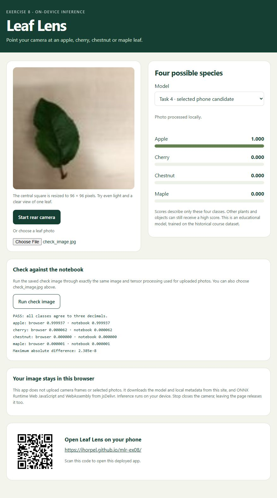

# Task 2 Review

This draft is based on the saved browser checks and code. The physical phone test and phone screenshot still need to be added.

## Running the page

The page is available at https://ihorpel.github.io/mlr-ex08/. In the browser check, the model loaded and an upload of check_image.jpg produced probabilities for all four classes. The layout also fitted a phone-width viewport without horizontal scrolling.

The rear-camera code is in index.html:162. It requests the environment-facing camera and uses a muted video with playsinline. Stop and leaving the page release the camera. These code and browser checks do not confirm that the camera works on a real Android phone or iPhone.

The physical phone model, browser, camera result and required screenshot are still pending. The screenshot below records the browser verification only.

## Comparing the probabilities

The check image was run through the page and compared with check_expected.json. The Task 2 model gave the following results.

| Class | Notebook probability | Browser probability |
| --- | ---: | ---: |
| Apple | 0.950652 | 0.950653 |
| Cherry | 0.049347 | 0.049347 |
| Chestnut | 0.000000 | 0.000000 |
| Maple | 0.000000 | 0.000000 |

Every class agrees to three decimal places. The maximum absolute difference was about 0.000000665. The selected Task 4 model also passed, with a maximum difference of about 0.000000024. An actual file-chooser upload worked as well as the built-in check button. The recorded results are in evidence/browser_check.json.

## Checking the preprocessing

The preprocess function in index.html:85 crops the central square and resizes it to the size in model_info.json, which is 96 by 96. It divides the RGB values by 255, then applies the channel means and standard deviations. The tensor has shape [1, 3, 96, 96], with red, green and blue in separate channel planes.

The mean is [0.485, 0.456, 0.406] and the standard deviation is [0.229, 0.224, 0.225]. These match model_info.json and the normalization in leaf_pipeline.py:26. Both exported models also contain matching metadata. The model returns logits, and the page applies softmax afterwards.

## Checking privacy

The app processes the image in a canvas and runs the model in the browser. Its code does not send camera frames or uploaded photos to a server. The fetch calls load the local model information, expected probabilities and check image. The model files also come from the same site. ONNX Runtime Web downloads its JavaScript and WebAssembly from the pinned jsDelivr URL in index.html:61 and index.html:70.

The QR code is generated locally and opens this app's published URL. No external QR-image service is used. These findings describe the app code and saved browser checks, rather than a separate network-traffic audit.

## Dataset and remaining checks

The model was trained on the historical ZIP supplied for this run, not the current group's photographs. The teacher's acceptance of this substitution has not been confirmed. The physical phone-camera check, phone screenshot and the student's own verification of this draft remain necessary before calling the review complete.
